# Kode Diagram SKPL Doctor Computer (Draw.io / Mermaid)

Dokumen ini berisi **kode diagram saja** dan tidak mengubah dokumen SKPL DOCX.

- BPMN AS-IS: [proses-bisnis-as-is.bpmn](./proses-bisnis-as-is.bpmn)
- BPMN TO-BE: [proses-bisnis-to-be.bpmn](./proses-bisnis-to-be.bpmn)
- BPMN transaksi POS dan sinkronisasi offline: [proses-pos-to-be.bpmn](./proses-pos-to-be.bpmn)

## Cara memakai

- **BPMN AS-IS, TO-BE, dan POS offline:** buka masing-masing file `.bpmn` di Camunda Modeler.
- **DFD, Use Case, Activity, Sequence, Class, ERD:** di diagrams.net/draw.io pilih **Arrange → Insert → Mermaid**, tempel satu blok Mermaid, lalu pilih **Insert**.
- Mermaid tidak memiliki notasi Use Case UML native. Kode Use Case di bawah memakai aktor dan oval use case di dalam batas sistem, sehingga tetap bisa dirender oleh fitur Mermaid di draw.io.
- BPMN merinci keputusan, alur alternatif, aktivitas administrasi, dan penanganan kegagalan push. Proses POS offline dipisahkan agar alur transaksi pelanggan dan POS lebih mudah dibaca.
- Simpan setiap diagram sebagai halaman/berkas terpisah agar mudah diekspor ke PNG, SVG, atau PDF.

Catatan pemodelan: alur mengikuti fitur yang ada pada aplikasi dan skema Supabase. Checkout pelanggan membutuhkan koneksi; mode offline hanya untuk POS kasir/admin. Aplikasi mencatat metode pembayaran, bukan memproses pembayaran melalui payment gateway. Resi dapat dilacak, tetapi tidak ada pelacakan GPS kurir secara live. Notifikasi status pesanan disimpan ke `user_notifications`; webhook Supabase meneruskan event ke Edge Function/FCM untuk push ke perangkat.

---

## DFD Level 0 — Diagram Konteks

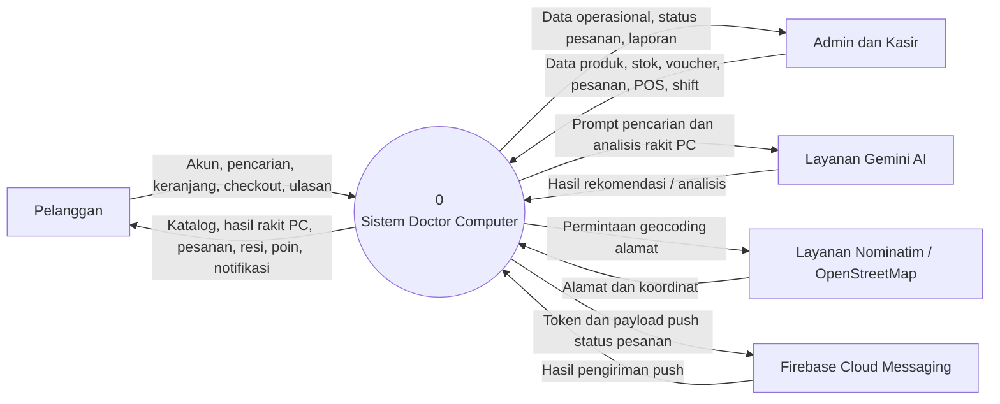

## DFD Level 1 — Proses Utama

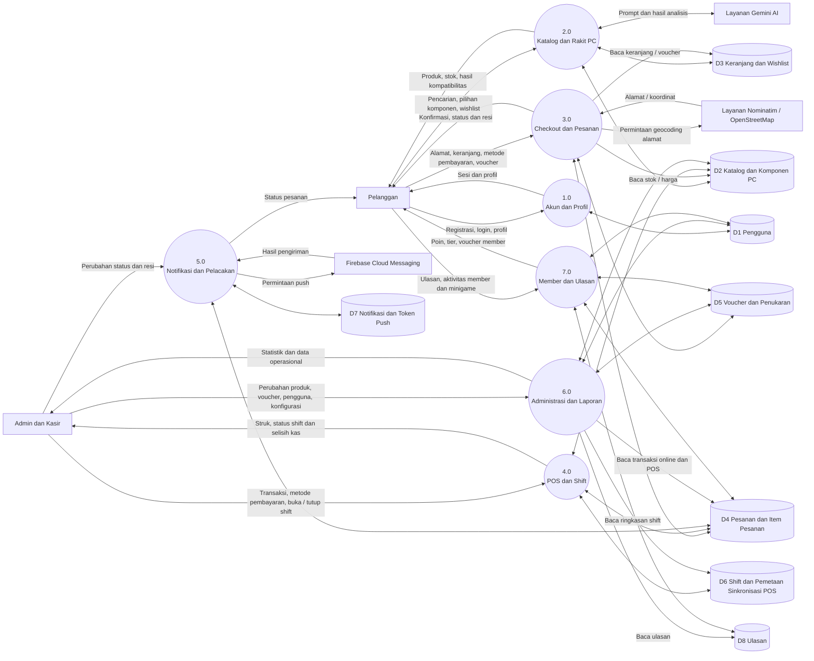

## DFD Level 2 — Proses 3.0 Checkout dan Pesanan

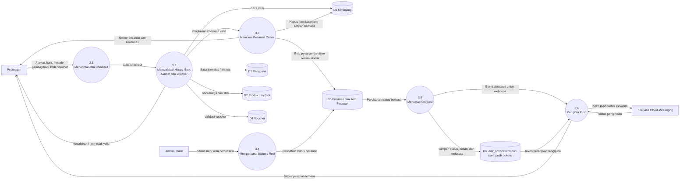

## DFD Level 2 — Proses 4.0 POS dan Shift

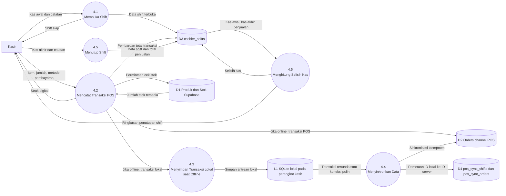

## Use Case Diagram

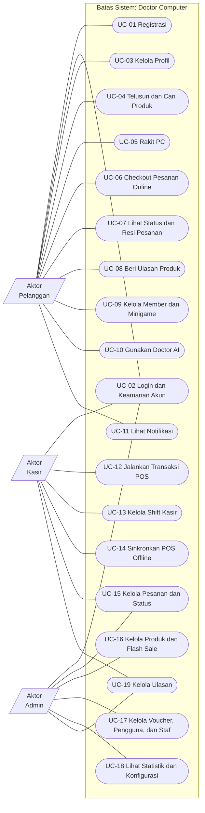

## Activity Diagram UC-02 — Login

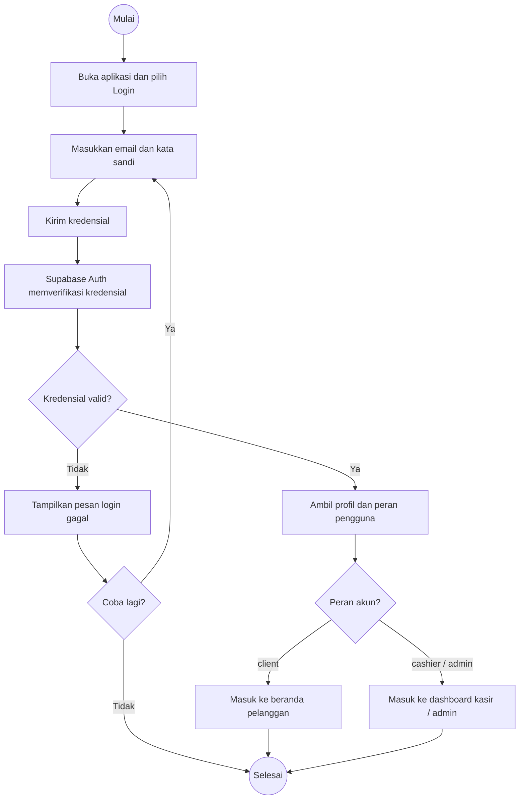

## Activity Diagram UC-05 — Rakit PC

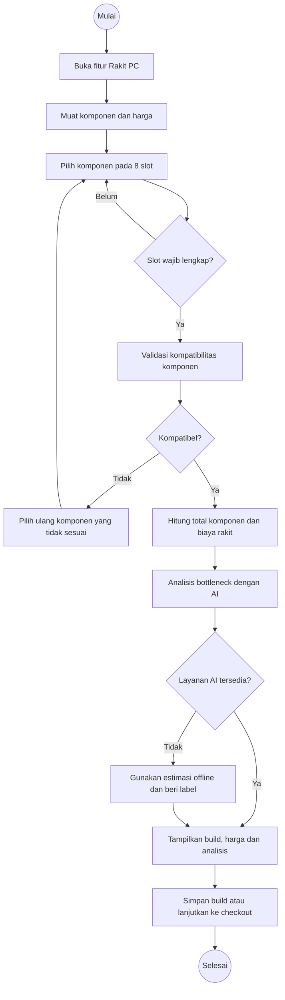

## Activity Diagram UC-06 — Checkout Pesanan Online

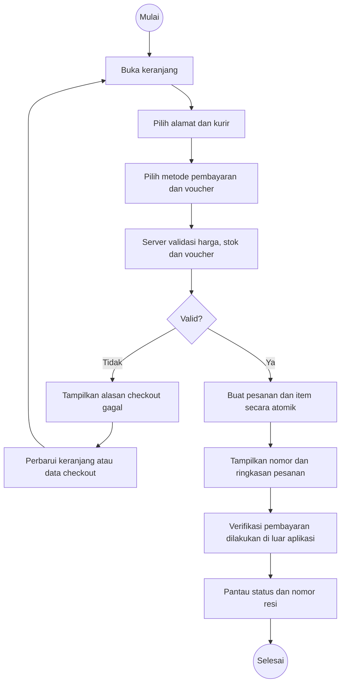

## Activity Diagram UC-12 — Transaksi POS

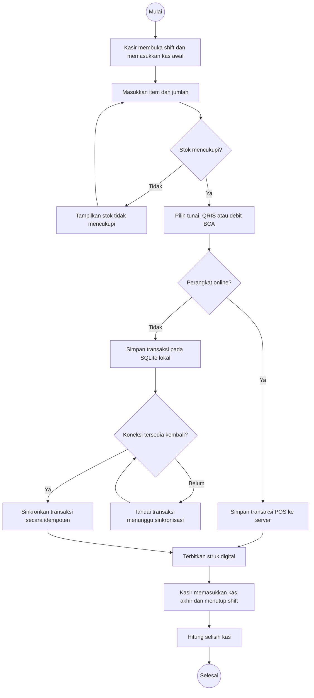

## Sequence Diagram UC-02 — Login

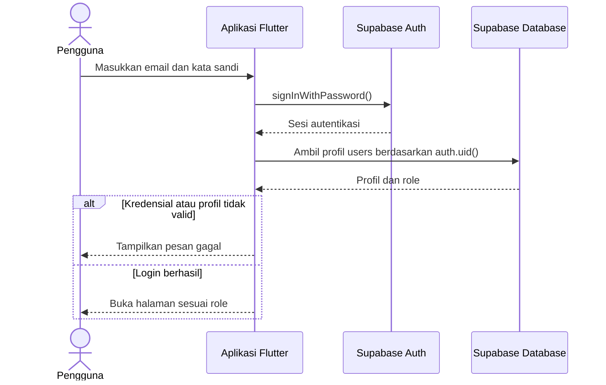

## Sequence Diagram UC-05 — Rakit PC

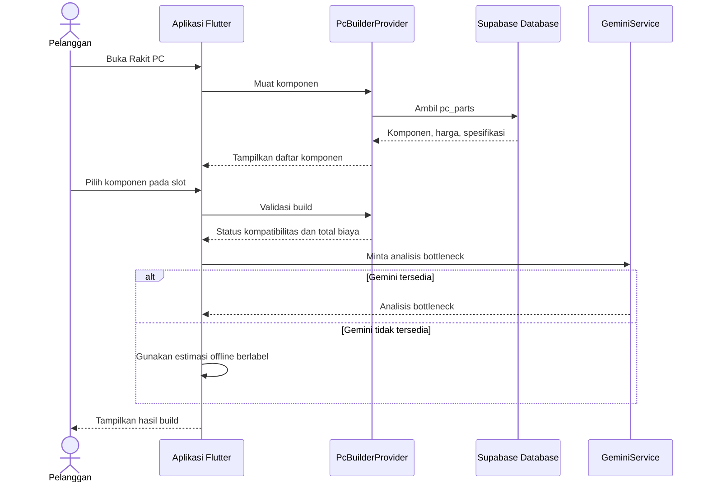

## Sequence Diagram UC-06 — Checkout dan Notifikasi Status

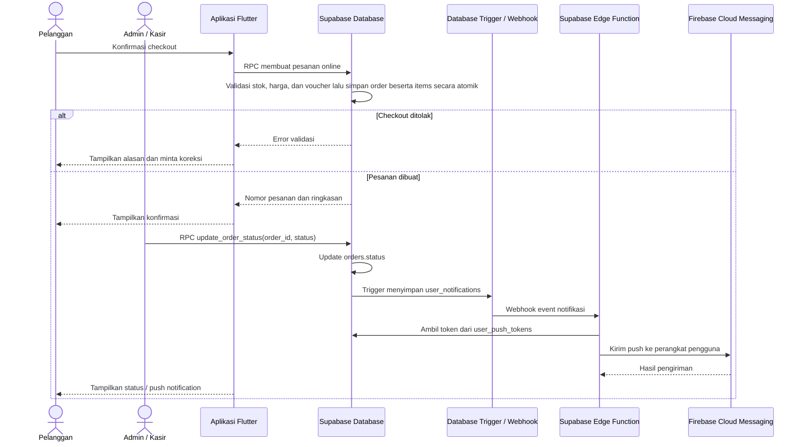

## Sequence Diagram UC-12 — POS dan Sinkronisasi Offline

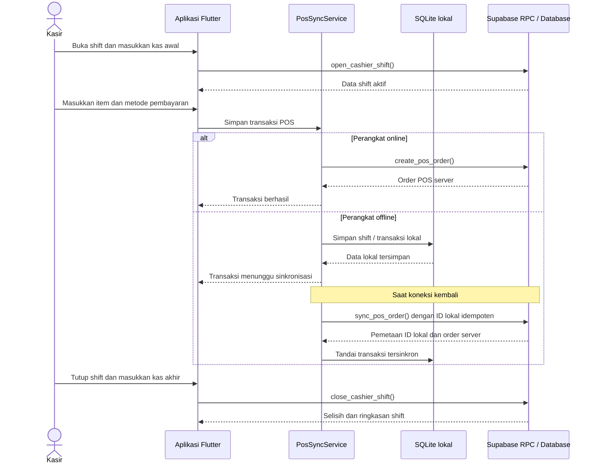

## Class Diagram — Ringkasan Arsitektur Aplikasi

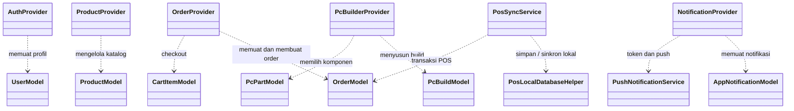

## ERD — Tabel Utama Supabase dan POS Offline

```mermaid
erDiagram
    USERS {
        varchar id PK
        varchar email
        varchar role
        varchar membership_tier
        integer points
    }
    MEMBERSHIP_TIERS {
        varchar tier PK
        varchar name
        integer required_points
    }
    CATEGORIES {
        varchar id PK
        varchar name
    }
    PRODUCTS {
        varchar id PK
        varchar category_id FK
        varchar name
        numeric price
        integer stock
    }
    CART_ITEMS {
        uuid id PK
        varchar user_id FK
        varchar product_id FK
        integer quantity
    }
    WISHLIST {
        varchar user_id PK
        varchar product_id PK
    }
    PC_PARTS {
        varchar id PK
        varchar category
        varchar name
        numeric price
    }
    PC_BUILDS {
        uuid id PK
        varchar user_id FK
        varchar cpu_id FK
        varchar gpu_id FK
        varchar motherboard_id FK
        varchar ram_id FK
        varchar storage_id FK
        varchar psu_id FK
        varchar case_id FK
        varchar cooler_id FK
        numeric grand_total
    }
    ORDERS {
        varchar id PK
        varchar user_id FK
        varchar cashier_id
        varchar channel
        varchar status
        numeric total_price
        varchar voucher_code
    }
    ORDER_ITEMS {
        uuid id PK
        varchar order_id FK
        varchar product_id FK
        integer quantity
        numeric unit_price
    }
    REVIEWS {
        varchar id PK
        varchar user_id FK
        varchar product_id FK
        varchar order_id FK
        numeric rating
    }
    VOUCHERS {
        uuid id PK
        varchar code
        varchar discount_type
        numeric discount_value
        varchar reward_type
    }
    VOUCHER_REDEMPTIONS {
        uuid id PK
        uuid voucher_id FK
        varchar user_id
        varchar order_id FK
        numeric discount_amount
    }
    CASHIER_SHIFTS {
        uuid id PK
        varchar cashier_id FK
        numeric opening_cash
        numeric closing_cash
        varchar status
    }
    POS_SYNC_SHIFTS {
        varchar cashier_id PK
        uuid local_shift_id PK
        uuid remote_shift_id FK
    }
    POS_SYNC_ORDERS {
        varchar cashier_id PK
        uuid local_order_id PK
        varchar remote_order_id FK
    }
    USER_NOTIFICATIONS {
        text id PK
        varchar user_id FK
        text order_id
        text type
        boolean is_read
    }
    USER_PUSH_TOKENS {
        text token PK
        varchar user_id FK
        text platform
    }

    CATEGORIES ||--o{ PRODUCTS : mengelompokkan
    USERS ||--o{ CART_ITEMS : memiliki
    PRODUCTS ||--o{ CART_ITEMS : dimasukkan
    USERS ||--o{ WISHLIST : memiliki
    PRODUCTS ||--o{ WISHLIST : disukai
    USERS o|--o{ PC_BUILDS : menyimpan
    PC_PARTS o|--o{ PC_BUILDS : mengisi_slot_komponen
    USERS ||--o{ ORDERS : membuat
    ORDERS ||--|{ ORDER_ITEMS : berisi
    PRODUCTS o|--o{ ORDER_ITEMS : dijual
    USERS o|--o{ REVIEWS : menulis
    PRODUCTS ||--o{ REVIEWS : menerima
    ORDERS o|--o{ REVIEWS : menjadi_dasar
    VOUCHERS ||--o{ VOUCHER_REDEMPTIONS : ditukarkan
    ORDERS ||--o| VOUCHER_REDEMPTIONS : menggunakan
    USERS ||--o{ CASHIER_SHIFTS : membuka
    CASHIER_SHIFTS ||--o{ POS_SYNC_SHIFTS : dipetakan_dari_lokal
    USERS ||--o{ POS_SYNC_SHIFTS : disinkronkan_oleh
    ORDERS ||--o| POS_SYNC_ORDERS : dipetakan_dari_lokal
    USERS ||--o{ POS_SYNC_ORDERS : disinkronkan_oleh
    USERS ||--o{ USER_NOTIFICATIONS : menerima
    USERS ||--o{ USER_PUSH_TOKENS : mendaftarkan
```

Catatan ERD:
- Kolom `membership_tier` pada `users` menyimpan tier membership; skema dasar tidak mendeklarasikan foreign key ke `membership_tiers`.
- `user_notifications.order_id` dan `voucher_redemptions.user_id` tidak dideklarasikan sebagai foreign key pada migrasi; hubungan tersebut tidak digambar sebagai relasi fisik.
- `wishlist.user_id` dan `wishlist.product_id`, serta `cashier_id` pada tabel pemetaan POS adalah bagian dari primary key komposit sekaligus foreign key; Mermaid hanya menampilkan satu penanda key per atribut.
- `PC_BUILDS` mempunyai delapan foreign key opsional ke `PC_PARTS`, masing-masing untuk satu slot. Relasi ringkas di diagram mewakili semua slot tersebut.
- `POS_SYNC_*` adalah pemetaan idempotensi antara UUID transaksi SQLite lokal dan baris transaksi/shift server.
